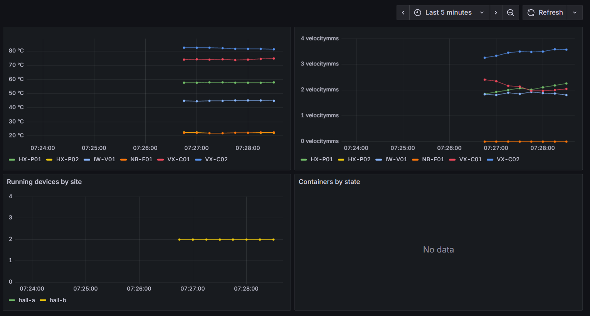

# docker-metrics-exporter

A small Prometheus exporter, **standard library only**, for two things:

1. a **simulated plant fleet** (compressors, pumps, a conveyor, a fan) so you can see a realistic dashboard without real machines;
2. the **container inventory of a Docker host**, read from the Engine API (opt-in).

It ships with a Prometheus + Grafana compose stack, alert rules and a provisioned dashboard.
All devices, brands (Vortex, Helix, Ironwood, Nimbus) and numbers are invented. No real company data.

## Dashboard preview



## What it exports

| Metric | Type | Meaning |
|---|---|---|
| `plant_device_info{device,kind,brand,model,site}` | gauge | static facts, value always 1 |
| `plant_device_running{device}` | gauge | 1 running / 0 stopped |
| `plant_device_temperature_celsius{device}` | gauge | housing temperature |
| `plant_device_vibration_rms_mm_per_s{device}` | gauge | vibration velocity, RMS |
| `plant_device_vibration_alarm{device}` | gauge | 1 above 7.0 mm/s (an illustrative threshold, not from a standard) |
| `plant_device_runtime_seconds_total{device}` | counter | accumulated running time, sampled at scrape time |
| `plant_fleet_devices` | gauge | number of simulated devices |
| `docker_containers{state}` | gauge | containers per state (`created`, `running`, `paused`, `restarting`, `removing`, `exited`, `dead`, `unknown`) |
| `docker_container_info{name,image,container_id}` / `docker_container_running{name}` / `docker_container_created_timestamp_seconds{name}` | gauge | per container |
| `docker_containers_omitted` | gauge | containers left out of per-container series by the cap |
| `exporter_collector_success{collector}` / `exporter_collector_duration_seconds{collector}` | gauge | health of each source in this scrape |
| `exporter_build_info{version,python}` | gauge | exporter version |

The simulated readings are a **pure function of (seed, device, time)**: no random state, so a test can pin the clock and get the same numbers.
The one stateful value is the hour meter, which only ever grows (a clock that steps backwards adds nothing).

## Run it

```bash
uv sync
uv run metrics-exporter scrape                      # print one scrape and exit
uv run metrics-exporter serve                       # http://127.0.0.1:9877/metrics  (loopback by default)
uv run metrics-exporter serve --docker              # also export Docker containers (needs the socket)

# Prometheus + Grafana (see "What was and was not verified" below)
GRAFANA_ADMIN_PASSWORD=choose-one docker compose up --build
#   Grafana    http://127.0.0.1:3000   (dashboard "plant-overview", provisioned)
#   Prometheus http://127.0.0.1:9090
# Container inventory as well (opt-in profile, read the warning below first):
DOCKER_GID=$(getent group docker | cut -d: -f3) GRAFANA_ADMIN_PASSWORD=choose-one \
  docker compose --profile docker up --build
```

## A real run

`metrics-exporter scrape`, first lines and the self-metrics (Python 3.13):

```
# HELP plant_device_running 1 while the device is running, 0 while stopped.
# TYPE plant_device_running gauge
plant_device_running{device="VX-C01"} 1
plant_device_running{device="VX-C02"} 0
...
# HELP plant_device_vibration_alarm 1 when vibration exceeds 7.0 mm/s.
# TYPE plant_device_vibration_alarm gauge
plant_device_vibration_alarm{device="HX-P02"} 1
...
exporter_collector_success{collector="fleet"} 1
exporter_collector_duration_seconds{collector="fleet"} 0.000265
exporter_build_info{python="3.13.16",version="0.1.0"} 1
```

`serve` probed with `curl`: `/healthz` → `200 ok`; `/metrics` → `200`, `text/plain; version=0.0.4; charset=utf-8`, 3439 bytes
(814 bytes with `Accept-Encoding: gzip`); `POST /metrics` → `405`; unknown path → `404`.

With `--docker` on a machine whose Docker daemon is not reachable, the fleet keeps working and the failure is visible instead of fatal:

```
WARNING collector 'docker' failed: DockerUnavailable: docker socket not found at /var/run/docker.sock
exporter_collector_success{collector="fleet"} 1
exporter_collector_success{collector="docker"} 0
```

## Design decisions

- **No `prometheus_client`.** The exposition format (text 0.0.4, `gauge` and `counter` only) is written by hand in `expo.py`, which is the point of the demo. Tests parse every scrape with a strict parser (a sample before its `TYPE`, a repeated `TYPE`, a duplicate series or a missing final newline all fail). For a real project, use the official client library; this exporter has no histograms, no summaries and no OpenMetrics.
- **One broken source must not blind the rest.** Each collector runs on its own; an exception, an invalid family, a series-cap breach or a metric-name clash drops *that collector's* output and sets `exporter_collector_success{collector}` to 0. The error detail goes to the log, never into the scrape.
- **Bounded everywhere:** series cap per collector (5000), container cap (500, with `docker_containers_omitted`), Docker response limit (8 MiB), Docker timeout (2 s), body-less `HEAD`, 10-second idle timeout per client connection.
- **Hostile strings are data, not syntax.** Container names and images are cut to 128 characters, newlines removed, and label values escaped. Unknown container states collapse into one `unknown` value so label cardinality cannot be driven from outside.
- **The deployment files are tested against the code** (`tests/test_deploy.py`): every metric and label used in the dashboard and alert rules must exist in a real scrape, scrape targets must be compose services on the exposed port, the dashboard's datasource uid must match the provisioning file. This is what stops a rename from silently turning a panel into "No data".
- **Alert thresholds live in one place.** The 7.0 mm/s limit is in the code (`plant_device_vibration_alarm`); the alert rule only checks `== 1`. The alarm is judged on the rounded value a dashboard displays, so the two can never disagree at the boundary.

### Security notes

- Binds to `127.0.0.1` by default; compose publishes Prometheus and Grafana on `127.0.0.1` only; the exporters publish no ports at all (reachable only on the compose network).
- Exporter containers: non-root (uid 10001), read-only root filesystem, all capabilities dropped, `no-new-privileges`.
- Grafana's admin password is **required** (`GRAFANA_ADMIN_PASSWORD`), never defaulted; sign-up and analytics are off; images are pinned.
- **The Docker socket is root-equivalent on the host**, and `:ro` on the mount does *not* make the API read-only (it only protects the socket file). The collector only ever sends `GET /containers/json`, but a compromised exporter container could send anything. That is why it lives in an opt-in compose profile. For anything beyond a demo, put a filtering socket proxy in front of the socket.
- `/metrics` has no authentication and no TLS. Keep it on a private network or put a reverse proxy in front.

## Tests

```bash
uv run pytest -q
uv run ruff check
python mutate8.py        # or: RUNNER="uv run pytest -q -x" python mutate8.py
```

109 tests: exposition rules (including hostile label values round-tripped through a strict parser), the exporter's failure isolation, a fake Docker Engine API on a unix socket (errors, slow daemon, oversized and malformed bodies), the HTTP server (routes, methods, gzip, `HEAD`, idle clients, concurrent scrapes), the simulator (determinism, physical ranges, the counter, the alarm boundary), the CLI, and the deployment-consistency checks above.

`mutate8.py` applies 43 deliberate bugs to a copy, one at a time, across the source *and* the deployment files (escaping removed, counters without `_total`, a failing collector breaking the scrape, `HEAD` with a body, the idle timeout removed, a dashboard pointing at a renamed metric, a port published on every interface, an unpinned image, the Docker socket mounted in the default exporter, the image running as root, ...). **43 of 43 are caught** (a hung mutant counts as caught).
The first run let three survive, and each was a real gap: the test for `HEAD` used `http.client`, which hides a stray body; the idle-timeout test overrode the very value the mutant changed; and the alarm test never landed exactly on the threshold, which also exposed that the alarm was judged on the unrounded value while the dashboard shows the rounded one. All three are fixed and have their own tests.

## What was and was not verified

Verified here: the 109 tests (on Python 3.11, 3.12 and 3.13), the mutation run, `metrics-exporter scrape` and `serve` with `curl`, and `docker compose config` accepts `compose.yaml` (and rejects it, as intended, when `GRAFANA_ADMIN_PASSWORD` is unset).

**Not verified** (the authoring sandbox had no Docker daemon, no `promtool`, no Prometheus or Grafana, and no PyPI access):

- the image build, `docker compose up`, and the healthcheck;
- that Prometheus accepts `prometheus.yml` and `rules.yml` (the tests check YAML structure and cross-references, not PromQL syntax);
- that Grafana loads `plant.json` and the panels render (no schema validation against a running Grafana 12);
- the Docker collector against a **real** daemon: it is tested only against a fake Engine API that returns the fields the code reads (`Id`, `Names`, `Image`, `State`, `Created`);
- `pytest` and `ruff` themselves. The tests were run with a small pytest-compatible shim; `uv run pytest` and `uv run ruff check` were not run by the author. Treat any difference as a bug in this repo.

## Limitations

- Simulated data only; the "fleet" is a function, not a protocol client. A real deployment would replace `FleetCollector` with one that reads OPC UA/Modbus/MQTT.
- The hour meter restarts from 0 when the process restarts (Prometheus handles that as a counter reset, so `rate()` and `increase()` stay correct).
- `docker_container_info` carries `container_id`, so a recreated container creates a new series. Fine for a demo; watch cardinality on a busy CI host.
- Collectors run on every scrape (no caching), so two Prometheus servers scraping the same exporter double the Docker API calls. `ThreadingHTTPServer` has no connection limit.
- Alert thresholds (90 °C, 7.0 mm/s) are illustrative, not engineering guidance.

## Development

Python 3.11+, `uv`. `uv.lock` is created by the first `uv sync`; commit it.

## License

MIT, see `LICENSE`.
